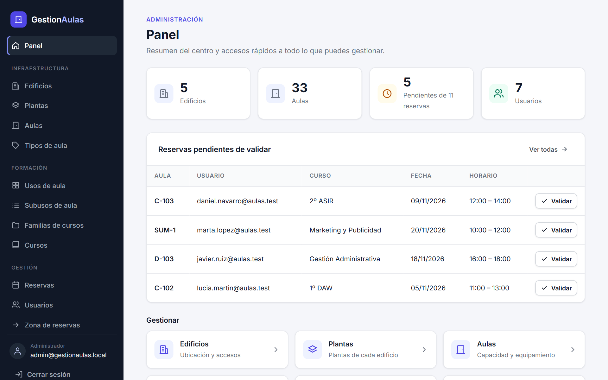
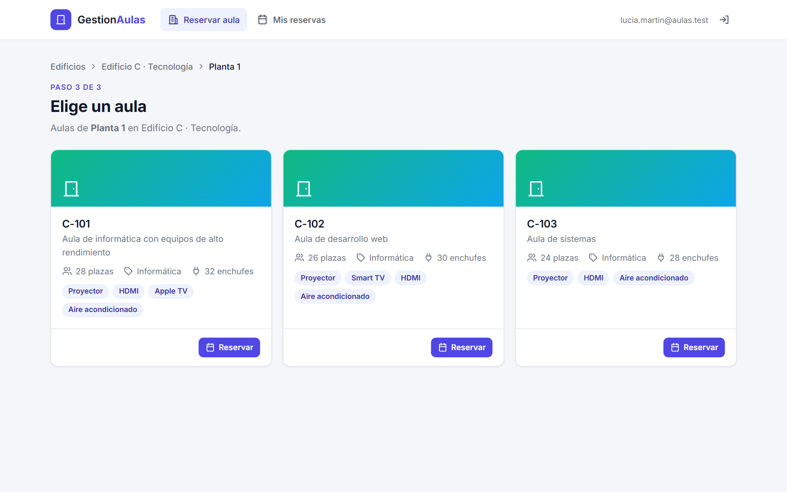
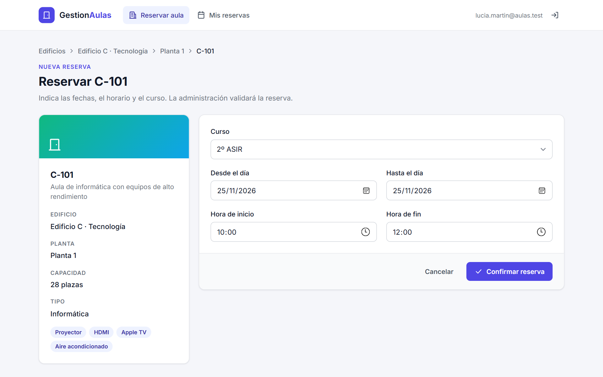
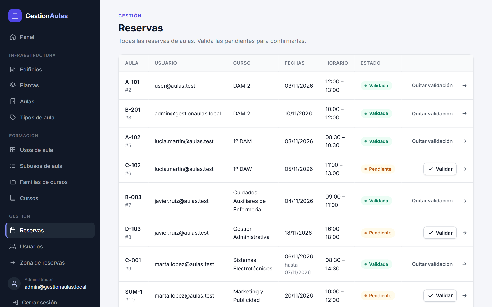
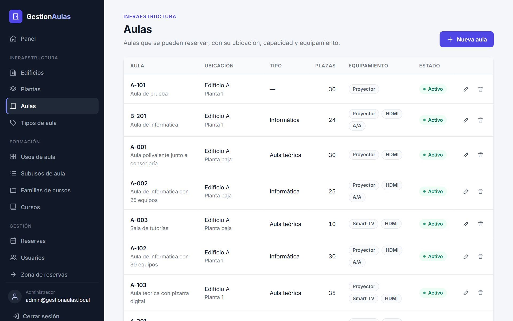
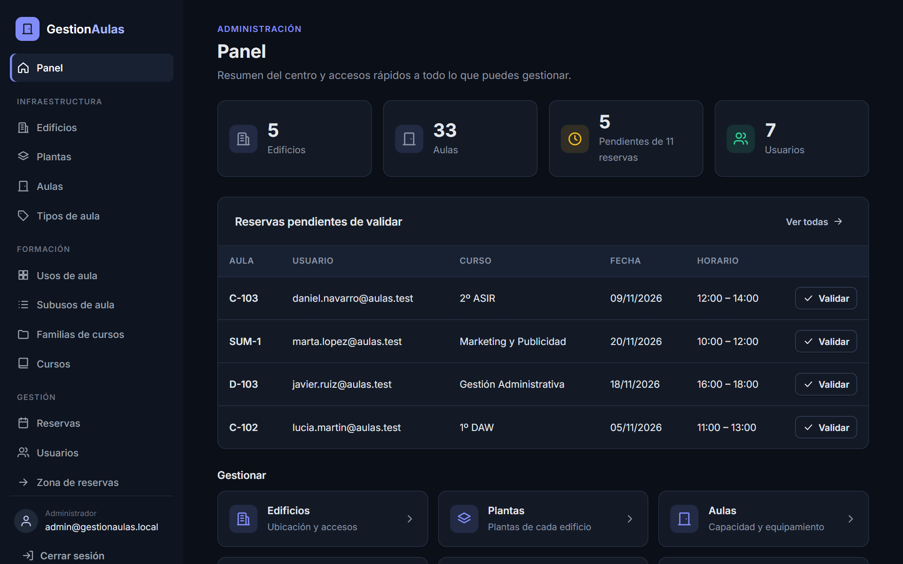
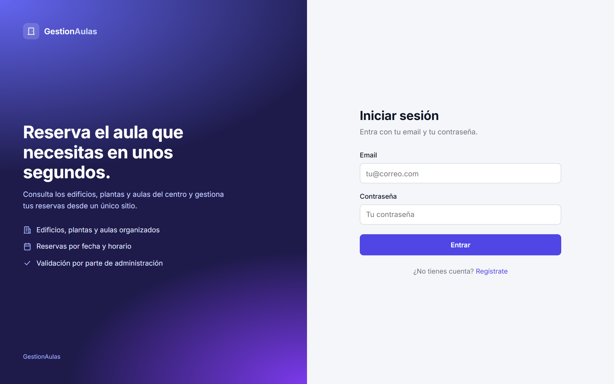
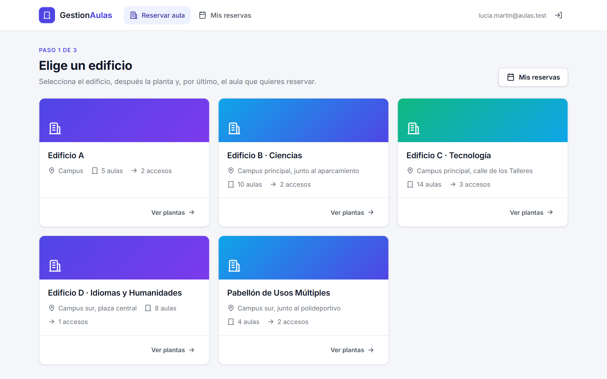
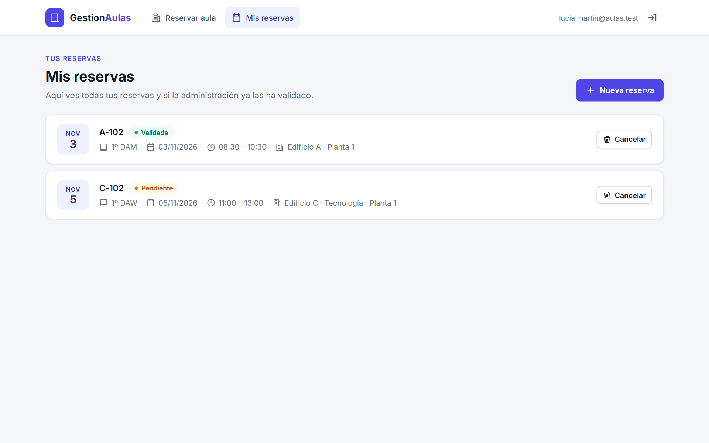
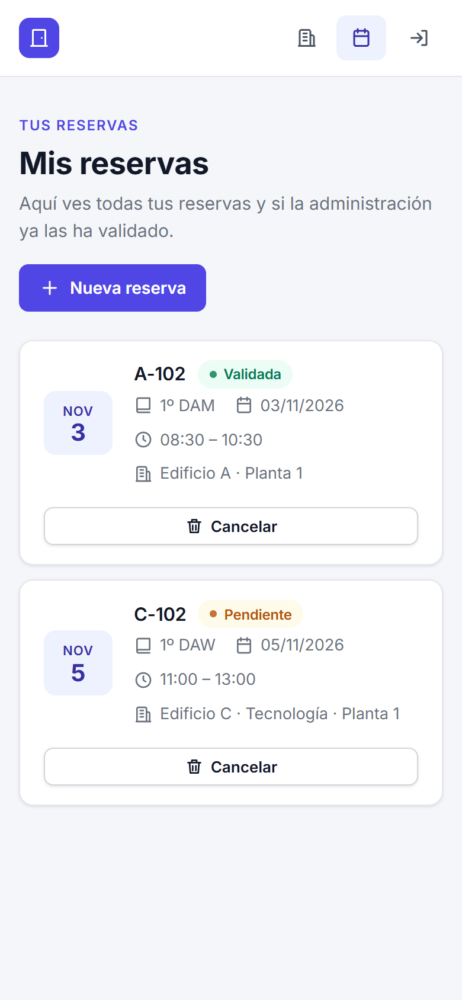

# 🏫 GestionAulas

[](https://github.com/ZaperMaster/GestionAulas/actions/workflows/build.yml)


[](LICENSE)

Aplicación web para gestionar los edificios, plantas y aulas de un centro educativo y
**reservar aulas** para impartir cursos. Hecha con **Spring Boot 2.6**, **Spring Security**,
**Thymeleaf** y **MySQL**.

## Capturas

<p align="center">
  
</p>

| Reservar: elegir aula | Reservar: formulario |
|---|---|
|  |  |
| **Gestión de reservas** | **Aulas (administración)** |
|  |  |
| **Modo oscuro** | **Inicio de sesión** |
|  |  |

<details>
<summary>Más capturas</summary>

| Elegir edificio | Mis reservas | Móvil |
|---|---|---|
|  |  |  |

</details>

## Funcionalidades

### Usuario
- Registro con DNI, nombre, email, contraseña y teléfono.
- Navegación **edificio → planta → aula**, con la capacidad, el tipo y el equipamiento de cada aula.
- Reserva de un aula para un curso, con fecha y horario.
- **Mis reservas**: consulta y cancelación de las reservas propias.

### Administrador
- Gestión completa (alta, edición y borrado) de edificios, plantas, aulas, tipos de aula,
  usos y subusos de aula, familias de cursos y cursos.
- **Gestionar reservas**: lista de todas las reservas y validación.
- **Gestión de usuarios**: cambio de rol entre usuario y administrador.

### Interfaz
- Diseño común para toda la aplicación: menú lateral en el panel de administración y barra
  superior en la zona de reservas, con modo claro y oscuro automático y adaptada a móvil.
- Panel de administración con resumen y validación rápida de las reservas pendientes.
- Reserva guiada en tres pasos (edificio → planta → aula) con el equipamiento de cada aula.

### Seguridad
- Contraseñas cifradas con **BCrypt**.
- Rutas de administración solo para el rol `ADMIN`; la zona de reservas para `USER` y `ADMIN`.
- Protección **CSRF**: los borrados y el cierre de sesión se hacen por `POST`.
- Cada usuario solo puede reservar a su nombre y cancelar sus propias reservas.

## Requisitos

- **Java 17** (por ejemplo, [Eclipse Temurin](https://adoptium.net/)).
- **MySQL 8**.
- No hace falta instalar Maven: el proyecto incluye el *wrapper* (`mvnw` / `mvnw.cmd`).

## Puesta en marcha

> **¿Solo quieres probarla?** Descarga `gestion-aulas-1.0.0.jar` de la
> [última release](https://github.com/ZaperMaster/GestionAulas/releases/latest), arranca MySQL
> y ejecuta `java -jar gestion-aulas-1.0.0.jar`. No necesitas compilar nada.


1. Arranca MySQL. Por defecto la aplicación se conecta a `localhost:3306` con el usuario
   `root` y la contraseña `root`, y crea la base de datos `gestoraulas` si no existe.
2. Arranca la aplicación:

   ```bash
   ./mvnw spring-boot:run
   ```

   En Windows: `mvnw.cmd spring-boot:run`. También puedes abrir el proyecto en Spring Tool
   Suite o IntelliJ y ejecutar `GestionAulasApplication` como *Spring Boot App*.
3. Abre <http://localhost:8080>.

### Primer administrador

Al arrancar con la base de datos vacía, la aplicación crea los tipos de usuario y un
administrador `admin@gestionaulas.local` con una **contraseña aleatoria que aparece una sola
vez en el log**. Para elegirla tú, arranca con la variable `ADMIN_PASSWORD`:

```bash
ADMIN_PASSWORD=MiClaveSegura ./mvnw spring-boot:run
```

Los usuarios que se registran desde `/registro` reciben el rol de usuario; un administrador
puede cambiarlo en *Gestión de usuarios*.

### Configuración

Todo se puede cambiar con variables de entorno, sin tocar `application.properties`:

| Variable | Por defecto | Para qué sirve |
|---|---|---|
| `PORT` | `8080` | Puerto de la aplicación |
| `DB_URL` | `jdbc:mysql://localhost:3306/gestoraulas?createDatabaseIfNotExist=true` | Conexión a MySQL |
| `DB_USER` | `root` | Usuario de MySQL |
| `DB_PASSWORD` | `root` | Contraseña de MySQL |
| `ADMIN_EMAIL` | `admin@gestionaulas.local` | Email del administrador inicial |
| `ADMIN_PASSWORD` | *(aleatoria)* | Contraseña del administrador inicial |

### Base de datos

Las tablas las crea Hibernate al arrancar. Si prefieres crearlas a mano, el script
[`mysql/gestoraulas.sql`](mysql/gestoraulas.sql) contiene la estructura completa y los
tipos de usuario:

```bash
mysql -u root -p < mysql/gestoraulas.sql
```

### Datos de ejemplo

Para probar la aplicación con datos realistas, carga [`mysql/datos_ejemplo.sql`](mysql/datos_ejemplo.sql)
después de arrancarla una vez:

```bash
mysql -u root -p --default-character-set=utf8mb4 gestoraulas < mysql/datos_ejemplo.sql
```

Añade 5 edificios, 11 plantas, más de 30 aulas con su equipamiento, tipos de aula, usos,
familias, 9 cursos, 4 usuarios y algunas reservas. Se puede ejecutar varias veces sin
duplicar nada. Los usuarios de ejemplo (`lucia.martin@aulas.test`, `javier.ruiz@aulas.test`,
`marta.lopez@aulas.test` y `daniel.navarro@aulas.test`) tienen la contraseña `Ejemplo2026!`;
son solo para pruebas.

Modelo de datos:

```
EDIFICIO 1──n PLANTA 1──n AULA n──1 TIPOAULA
USOAULA 1──n SUBUSOAULA 1──n FAMCURSO 1──n CURSO
RESERVA: AULA + USUARIO + CURSO + fechas y horario (activo, validar)
USUARIO n──1 TIPOUSUARIO (1 = ADMIN, 3 = USER)
```

## Estructura

```
src/main/java/com/alejandronieves/
├── GestionAulasApplication.java   Clase principal
├── config/
│   ├── SecurityConfig.java        Login, roles y rutas protegidas
│   └── DataInitializer.java       Tipos de usuario y administrador inicial
├── controller/                    Controladores web (uno por pantalla o entidad)
├── model/                         Entidades JPA
├── repository/                    Repositorios Spring Data
├── service/                       Interfaces de servicio
└── serviceImpl/                   Implementaciones
src/main/resources/
├── application.properties
├── templates/                     Vistas Thymeleaf
│   └── fragments/layout.html      Cabecera, menús, iconos y piezas comunes
└── static/                        app.css y app.js (estilos y comportamiento comunes)
mysql/gestoraulas.sql              Script de la base de datos
mysql/datos_ejemplo.sql            Datos de ejemplo
```

## Licencia

[MIT](LICENSE) ([traducción al español](LICENCIA.md)).

## Autor

Hecho por [ZaperMaster](https://github.com/ZaperMaster).
